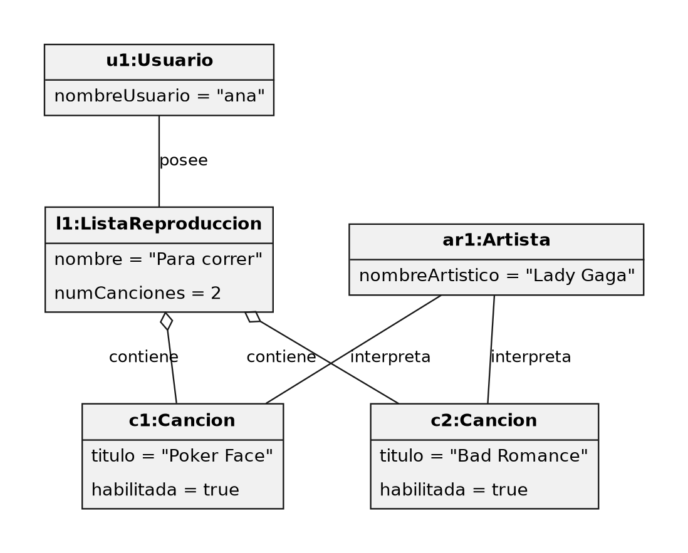
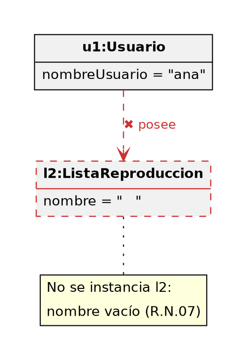
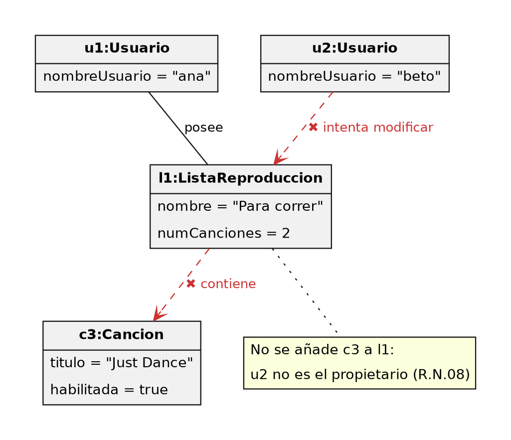
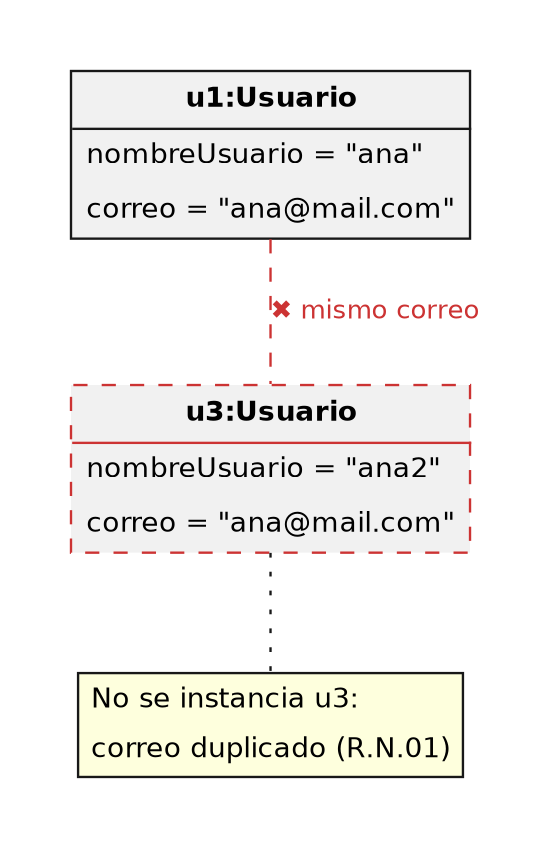
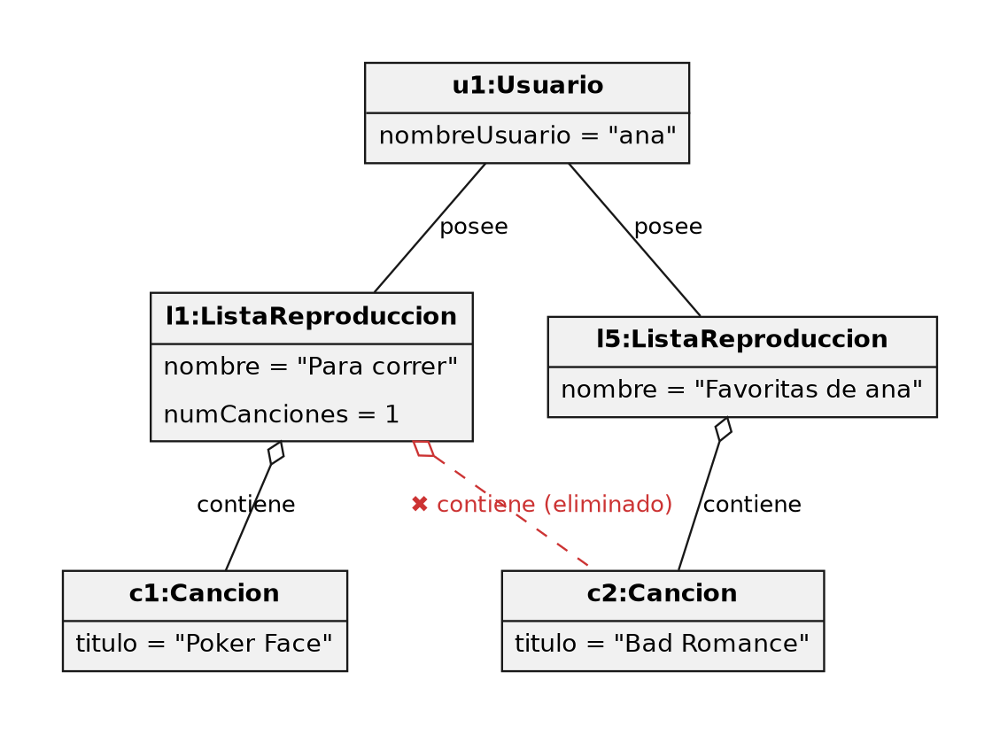
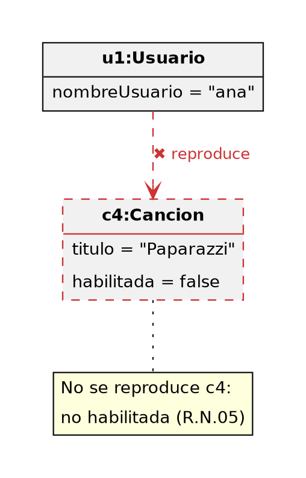

# Sotify

## Miembros del grupo L2-ABS-11

1. Pérez Ponce, Ignacio
2. Guichot Vila, Mario
3. Redondo Rosco, Diana
4. Barbero Luna, Alvaro

---

## 1. Introducción al problema

### Situacion actual
Spotify ha caido en una demanda por practicas monopolisticas por la CNMC (Comisión Nacional de los Mercados y la Competencia) y actualmente se encuentra inoperativa. Para ello, a compañía ha tomado la decisión de dividirse en dos entidades independientes: por un lado, Spotify, y por otro, Sotify, planteada como la alternativa antimonopolio ofrecida por la CNMC. El proyecto consiste en diseñar la aplicación de streaming musical junto con su base de datos que permita organizar y gestionar la información de manera eficiente.

## Problemas detectados
La situación actual plantea diversas necesidades críticas que deben resolverse para poner en marcha el servicio:

* **Inoperatividad del servicio**: A raíz de la demanda de la CNMC y la posterior partición de la empresa, el servicio se encuentra inactivo y requiere una nueva plataforma funcional para operar bajo el marco antimonopolio.
* **Ausencia de estructura de datos definida**: No existe un modelo implementado para Sotify que represente las relaciones entre las distintas entidades del negocio (usuarios, artistas, álbumes, canciones y listas de reproducción).

### Expectativas y Solución
El objetivo del proyecto es diseñar la aplicación de streaming musical Sotify junto con su base de datos, desarrollando un modelo que represente correctamente las relaciones entre las distintas entidades. Además de optimizar la gestión, consulta y actualización de los datos.

Las expectativas principales para el nuevo sistema son:
1. **Gestión e interacción de usuarios**: Permitir a los usuarios crear sus propias listas de reproducción, seguir a sus artistas favoritos, reproducir canciones y consultar su historial de música.
2. **Gestión de contenido para artistas**: Facilitar a los artistas la publicación de sus álbumes y canciones, además de permitirles reproducir música dentro de la propia plataforma.
3. **Eficiencia estructural**: Consolidar una base de datos con un rendimiento y una organización superiores a la versión original, satisfaciendo de forma íntegra las necesidades tanto de los usuarios como de los artistas.

*Logo de Sotify*

---

## 2. Glosario de términos

Este glosario recoge los principales términos relacionados con el dominio del problema de la aplicación de reproducción musical. Su finalidad es establecer un vocabulario común que facilite la comprensión de los requisitos, las funcionalidades y el modelo de datos del sistema.

**Álbum:** Conjunto de canciones publicadas como una misma obra musical. Un álbum dispone de información como el título, la fecha de publicación y la portada, y puede estar asociado a uno o varios artistas.

**Artista:** Persona o grupo musical que interpreta o crea canciones. Un artista puede estar asociado a varias canciones y álbumes.

**Búsqueda musical:** Funcionalidad que permite localizar canciones, artistas o álbumes mediante criterios como el título de una canción o el nombre de un artista.

**Canción:** Unidad de contenido musical que el usuario puede consultar y reproducir desde la aplicación. Puede tener atributos como el título, la duración y el álbum al que pertenece.

**Catálogo musical:** Conjunto de canciones, álbumes y artistas disponibles en la aplicación para su consulta y reproducción.

**Cuenta de usuario:** Conjunto de datos que identifica a un usuario registrado y permite gestionar su acceso a las funcionalidades personalizadas de la aplicación.

**Género musical:** Categoría que permite clasificar canciones según sus características musicales, como pop, rock, jazz o música clásica.

**Lista de reproducción:** Colección de canciones creada por un usuario para agrupar y organizar música según sus preferencias. Puede tener un nombre y contener varias canciones.

**Reproducción:** Acción mediante la cual el usuario escucha una canción a través de la aplicación.

**Reproductor musical:** Componente de la aplicación que permite controlar la reproducción de canciones, incluyendo acciones como reproducir y pausar.

**Streaming de audio:** Tecnología que permite transmitir contenido de audio para su reproducción a través de una conexión de red, sin necesidad de descargar previamente el archivo completo.

**Usuario:** Persona que utiliza la aplicación para buscar música, escuchar canciones y gestionar sus listas de reproducción. En caso de disponer de una cuenta registrada, podrá acceder a las funcionalidades personalizadas que ofrezca el sistema.

**Modo aleatorio:** Funcionalidad que permite al usuario escuchar una lista de reproducción sin un orden definido

---

## 3. Visión general del sistema

### 3.1. Requisitos generales
* **Gestión de usuarios**: la aplicación permitirá el registro y la administración de los distintos usuarios del sistema: Administrador, Cliente y Artista. Los artistas podrán 
* **Gestión de catálogo musical**: se podrá realizar registro, creación, modificación y administración del catálogo musical (Canciones, Álbumes y Artistas).
* **Gestión de listas de reproducción personales**: la aplicación permitirá crear de listas personales por los usuarios para almacenar canciones de álbumes (sea una o varias). También se podría almacenar el álbum entero, añadiendo todas las canciones dentro de la lista.
* **Gestión de control de reproducción multimedia**: la aplicación podrá reproducir el contenido multimedia, pudiendo iniciar y pausar canciones. Además, también se podrá adelantar a la siguiente canción o retroceder a la anterior.

### 3.2. Usuarios del sistema

* **Usuario**: usuario registrado dentro de la aplicación, haciendo uso de la misma. El usuario puede buscar contenido en el catálogo, reproducir y pausar canciones, y gestionar sus propias listas de reproducción personales.
* **Administrador**: responsable de la aplicación con la capacidad de realizar las acciones CRUD de todo el contenido (música, álbumes, listas, artistas y usuarios.
* **Artista**: usuario de tipo especial con la capacidad de crear contenido multimedia (música y álbumes), además de las capacidades de un usuario básico, es decir, pudiendo reproducir música y crear listas personales.

---

## 4. Catálogo de requisitos

### 4.1. Requisitos funcionales

#### R.F.01. Consulta del catálogo musical

* **Como**: Usuario
* **Quiero**: Listar las canciones, artistas y álbumes disponibles en la aplicación, y consultar las canciones asociadas a un álbum o a un artista.
* **Para**: Descubrir la música disponible en el catálogo.

#### R.F.02. Filtrado de canciones por género musical

* **Como**: Usuario
* **Quiero**: Consultar y clasificar las canciones según su género musical.
* **Para**: Encontrar obras musicales que se ajusten a un estilo concreto.

#### R.F.03. Búsqueda de música

* **Como**: Usuario
* **Quiero**: Buscar canciones por su título, así como artistas y álbumes por su nombre.
* **Para**: Encontrar rápidamente la música que deseo escuchar.

#### R.F.04. Control de reproducción multimedia

* **Como**: Usuario
* **Quiero**: Iniciar y pausar canciones del catálogo, así como adelantar a la siguiente canción o retroceder a la anterior.
* **Para**: Escuchar la música disponible en la aplicación y controlar el orden de reproducción.

#### R.F.05. Reproducción en modo aleatorio

* **Como**: Usuario
* **Quiero**: Reproducir una lista de reproducción en modo aleatorio.
* **Para**: Escuchar las canciones de la lista sin un orden definido.

#### R.F.06. Creación de listas de reproducción

* **Como**: Usuario registrado
* **Quiero**: Crear listas de reproducción personales con un nombre.
* **Para**: Agrupar y organizar las canciones según mis preferencias.

#### R.F.07. Gestión de canciones y álbumes en una lista de reproducción

* **Como**: Usuario registrado
* **Quiero**: Añadir canciones individuales o un álbum entero (incorporando todas sus canciones) a mis listas de reproducción, y eliminarlas de ellas.
* **Para**: Mantener las listas actualizadas con la música que me interesa.

#### R.F.08. Modificación y eliminación de listas de reproducción

* **Como**: Usuario registrado
* **Quiero**: Cambiar el nombre de mis listas de reproducción o eliminarlas.
* **Para**: Mantener organizada mi colección musical.

#### R.F.09. Seguimiento de artistas

* **Como**: Usuario registrado
* **Quiero**: Seguir a mis artistas favoritos dentro de la plataforma.
* **Para**: Mantenerme vinculado a los artistas cuya música me interesa.

#### R.F.10. Consulta del historial de música

* **Como**: Usuario registrado
* **Quiero**: Consultar mi historial de canciones reproducidas.
* **Para**: Revisar la música que he escuchado anteriormente en la plataforma.

#### R.F.11. Publicación de álbumes

* **Como**: Artista
* **Quiero**: Publicar álbumes indicando su título, fecha de publicación, portada y el artista o artistas asociados.
* **Para**: Dar a conocer mis obras musicales completas dentro del catálogo de la plataforma.

---
  
### 4.1.1. Requisitos de información

##### R.I.01. Información sobre canciones

Como gestor de la aplicación, quiero disponer de la información correspondiente a cada canción del catálogo, incluyendo título, duración, artistas participantes, fecha de lanzamiento, letra, álbum al que pertenece y número de reproducciones, para mantenerla actualizada

##### R.I.02. Información sobre usuarios

Como gestor de la aplicación, quiero almacenar la siguiente información correspondiente a los usuarios registrados: nombre de usuario, correo electrónico, contraseña y fecha de nacimiento, para poder gestionarlos correctamente y mejorar su experiencia

##### R.I.03. Información sobre álbumes

Como gestor de la aplicación, quiero disponer de la información sobre el título, los artistas participantes, la portada y la fecha de lanzamiento de los álbumes, para poder gestionarlos dentro de la aplicación

##### R.I.04. Información sobre artistas

Como gestor de la aplicación, quiero almacenar la siguiente información sobre los artistas: nombre, nombre artístico, país, número de canciones, número de álbumes y número total de reproducciones

##### R.I.05. Información sobre listas de reproducción

Como gestor de la aplicación, quiero disponer de la información sobre el nombre, la cantidad de canciones incluidas, el creador de la lista y las canciones que contiene cada lista de reproducción, para poder gestionar las listas

##### R.I.06. Información sobre favoritos

Como gestor de la aplicación, quiero disponer de la información correspondiente a las canciones marcadas como favoritos, como el título, el usuario que la ha marcado como favorito, y la lista completa de canciones marcadas como favorito por un mismo usuario, para poder crear una lista de reproducción con las canciones favoritas de cada usuario

---

### 4.1.2. Reglas de negocio

##### R.N.01. Unicidad del correo electrónico

Cada cuenta de usuario debe estar asociada a una dirección de correo electrónico única. No se permitirá registrar dos cuentas con la misma dirección de correo electrónico.
* **Prueba de aceptación**:
- **Caso válido:** Ana se registra con `ana.hermoso.martin@mail.com` y ese correo no existe en el sistema -> el sistema crea la cuenta.
- **Caso inválido:** otra persona intenta registrarse con `ana.hermoso.martin@mail.com` -> el sistema rechaza el registro, muestra un mensaje de correo ya registrado y no crea la segunda cuenta.

##### R.N.02. Validación de los datos de registro

Para crear una cuenta, el usuario debe proporcionar todos los datos obligatorios y una dirección de correo electrónico con formato válido. La contraseña debe cumplir las condiciones de seguridad establecidas para la aplicación.
* **Prueba de aceptación**:
- **Caso válido:** el usuario completa todos los campos obligatorios, con correo `oscar@mail.com` y una contraseña que cumple las condiciones de seguridad -> el sistema crea la cuenta.
- **Caso inválido:** falta un dato obligatorio (por ejemplo, el nombre de usuario) -> el sistema bloquea el registro e indica el campo que falta.

##### R.N.03. Protección de las credenciales

Las contraseñas de los usuarios no deben almacenarse en texto plano. El sistema debe utilizar un mecanismo seguro de almacenamiento de contraseñas y comprobar las credenciales durante el inicio de sesión.
* **Prueba de aceptación**:
- **Caso válido:** Ana se registra con la contraseña `Clave#2026` -> el valor almacenado es un hash distinto de la contraseña original. Al iniciar sesión con `Clave#2026`, el sistema compara las credenciales y concede el acceso.
- **Caso inválido 1:** Ana intenta iniciar sesión con una contraseña incorrecta -> el sistema deniega el acceso.
- **Caso inválido 2:** se consulta la información almacenada de los usuarios -> en ningún caso aparece una contraseña en texto plano.

##### R.N.04. Autenticación para operaciones personales

Las operaciones de creación, modificación y eliminación de listas de reproducción requieren que el usuario haya iniciado sesión. El sistema debe verificar la identidad del usuario antes de permitir estas operaciones.
* **Prueba de aceptación**:
- **Caso válido:** Ana, con sesión iniciada, crea la lista «Para correr» -> el sistema permite la operación.
- **Caso inválido:** un visitante sin sesión intenta crear, renombrar o eliminar una lista -> el sistema bloquea la operación, solicita iniciar sesión y no modifica ninguna lista.

##### R.N.05. Disponibilidad del contenido musical

Solo podrán consultarse y reproducirse como contenido disponible las canciones que estén registradas en el catálogo y habilitadas para su reproducción.
* **Prueba de aceptación**:
- **Caso válido:** «Just Dance» está registrada en el catálogo con `habilitada = true` -> aparece en las consultas, se puede reproducir y se puede añadir a listas.
- **Caso inválido 1:** una canción con `habilitada = false` -> no se muestra como disponible, no se reproduce y no se puede añadir a una lista.
- **Caso inválido 2:** una canción que no existe en el catálogo -> el sistema no permite reproducirla ni asociarla a ninguna lista.

##### R.N.06. Propiedad de las listas de reproducción

Cada lista de reproducción debe estar asociada a un único usuario propietario. El usuario propietario será el responsable de gestionar el nombre de la lista y las canciones que contiene.
* **Prueba de aceptación**:
- **Caso válido:** Ana crea la lista «Para correr» -> la lista queda asociada a Ana como única propietaria y solo ella puede gestionarla.
- **Caso inválido 1:** se intenta crear una lista sin propietario -> el sistema rechaza la operación y no se crea la lista.
- **Caso inválido 2:** se intenta asignar dos propietarios a la misma lista -> el sistema rechaza la operación.

##### R.N.07. Validez del nombre de una lista

Toda lista de reproducción debe tener un nombre no vacío. No se permitirá crear una lista ni modificar su nombre utilizando únicamente espacios en blanco.
* **Prueba de aceptación**:
- **Caso válido:** Ana crea la lista «Para correr» o renombra otra a «Favoritas de Ana» -> el sistema acepta el nombre.
- **Caso inválido:** Ana intenta crear una lista con nombre vacío -> el sistema rechaza la operación y no se crea la lista (EP-02).

##### R.N.08. Control de acceso a las listas

Un usuario solo podrá modificar o eliminar las listas de reproducción de las que sea propietario. Tampoco podrá añadir o eliminar canciones de listas pertenecientes a otros usuarios.
* **Prueba de aceptación**:
- **Caso válido:** Ana añade «Just Dance» a su propia lista «Para correr» y, después, elimina esa lista -> el sistema permite ambas operaciones.
- **Caso inválido 1:** Oscar intenta añadir «Just Dance» a «Para correr», propiedad de Ana -> el sistema rechaza la operación y la lista conserva su contenido (EP-03).
- **Caso inválido 2:** Oscar intenta eliminar una canción de la lista de Ana o eliminar la lista completa -> el sistema bloquea la operación y la lista permanece intacta.

##### R.N.09. Integridad del catálogo musical

Eliminar una canción de una lista de reproducción no debe eliminar la canción del catálogo musical. La canción debe seguir disponible para otros usuarios y para otras listas, siempre que continúe habilitada en el catálogo.
* **Prueba de aceptación**:
- **Caso válido:** Ana elimina «Bad Romance» de su lista «Favoritas de Ana» -> la canción desaparece de esa lista, pero sigue existiendo en el catálogo y en otras listas que la contengan, como «Para correr» (EP-05).
- **Caso inválido:** al quitar una canción de una lista, el sistema la elimina también del catálogo -> la prueba falla. La canción debe seguir accesible para el resto de usuarios.

##### R.N.10. Integridad de las relaciones entre datos

Toda lista de reproducción debe estar asociada a un usuario existente, y toda canción incluida en una lista debe existir en el catálogo musical. El sistema no debe permitir relaciones que hagan referencia a usuarios, listas o canciones inexistentes.
* **Prueba de aceptación**:
- **Caso válido:** se añade una canción existente y habilitada a una lista existente, propiedad de un usuario existente -> el sistema crea la relación.
- **Caso inválido:** se intenta crear una lista asociada a un usuario inexistente -> el sistema rechaza la operación.

##### R.N.11. Conservación de la información personal

Las listas de reproducción y sus asociaciones con las canciones deben mantenerse almacenadas al cerrar sesión. Cuando el usuario vuelva a iniciar sesión, debe poder recuperar sus listas y consultar su contenido.
* **Prueba de aceptación**:
- **Caso válido:** Ana crea «Para correr» con dos canciones y cierra sesión. Al volver a iniciar sesión, encuentra la lista con el mismo nombre y las mismas dos canciones.
- **Caso inválido:** tras cerrar sesión, las listas de Ana desaparecen o pierden canciones -> la prueba falla. El sistema debe conservar siempre las listas y sus asociaciones.

### 4.2. Mapa de historias de usuario (opcional)

---

### 4.3. Requisitos no funcionales (opcional)

**R.N.F. 01. Disponibilidad 24/7**
Como gestor de la aplicación, quiero que la disponibilidad del sistema sea 24/7, para que los usuarios puedan reproducir contenido ininterrumpidamente

**R.N.F. 02. Disponibilidad sin conexión**
Como gestor de la aplicación, quiero que los usuarios puedan descargarse contenido, para que en caso de que pierdan la conexión, puedan seguir reproduciendo todo aquel contenido que tienen descargado

**R.N.F. 03. Seguridad**
Como gestor de la aplicación, quiero que no se pueda acceder a los datos personales de los usuarios y que las contraseñas estén cifradas de manera segura, para cumplir con la Ley de Protección de Datos y garantizar la tranquilidad del usuario

**R.N.F. 04. Rendimiento**
Como gestor de la aplicación, quiero que esta sea capaz de atender las peticiones de todos los usuarios, garantizando que los resultados se mostraran en pocos segundos

**R.N.F. 05. Compatibilidad**
Como gestor de la aplicación, quiero que garantice que los datos del usuario (listas de reproducción, artistas favoritos, etc) están sincronizados desde donde abra la aplicación, incluídos dispositivos distintos

**R.N.F. 06. Facilidad de uso**
Como gestor de la aplicación, quiero que sea intuitiva y sencilla de navegar, y que los usuarios puedan encontrar lo que busquen sin complicaciones

---

## 5. Modelo conceptual

### 5.1. Diagramas de clases UML

### 5.2. Escenarios de prueba

Para validar el modelo se definen los siguientes escenarios de instanciación con sus respectivos diagramas de objetos. Cada escenario indica los requisitos que ejercita. En los diagramas, las líneas discontinuas marcadas con ✖ representan enlaces que el modelo **no permite** crear y los objetos en rojo son instancias rechazadas.

#### ESCENARIO DE PRUEBA EP-01: Creación de una lista y adición de canciones

**Objetivo:** Comprobar que un usuario con sesión iniciada puede crear una lista con nombre válido y añadirle canciones habilitadas del catálogo.

**Descripción textual:** La clienta **ana** crea la lista de reproducción «Para correr». A continuación añade dos canciones habilitadas del catálogo, interpretadas por la artista **Lady Gaga**. El sistema acepta ambas operaciones y la lista queda asociada a su única propietaria.

**Objetos involucrados:**

- `u1:Usuario` (nombreUsuario="Ana")
- `l1:ListaReproduccion` (nombre="Para correr", numCanciones=2)
- `c2:Cancion` (titulo="Bad Romance")
- `c1:Cancion` (titulo="Poker Face")
- `ar1:Artista` (nombreArtistico="Lady Gaga") vinculada a `c1` y `c2`

---

#### ESCENARIO DE PRUEBA EP-02: Rechazo de lista con nombre vacío

**Objetivo:** Verificar que la regla de negocio *R.N.07* impide crear una lista cuyo nombre esté vacío o formado solo por espacios.

**Descripción textual:** La usuaria **ana** intenta crear una lista y escribe únicamente espacios en blanco como nombre. El sistema rechaza la operación, no se instancia la lista y la colección de Ana permanece sin cambios.

**Objetos involucrados:**

- `u1:Usuario` (nombreUsuario="ana")
- `l2:ListaReproduccion` (nombre="   ") -> **NO SE CREA**

---

#### ESCENARIO DE PRUEBA EP-03: Bloqueo de modificación de una lista ajena

**Objetivo:** Verificar que un usuario no puede añadir ni eliminar canciones de una lista de la que no es propietario.

**Descripción textual:** El usuario **Oscar** intenta añadir la canción «Just Danceg» a la lista «Para correr», cuya propietaria es **Ana**. El sistema detecta que **Oscar** no es el propietario, rechaza la operación y la lista conserva su contenido.

**Objetos involucrados:**

- `u1:Usuario` (nombreUsuario="Ana")
- `u2:Usuario` (nombreUsuario="Oscar")
- `l1:ListaReproduccion` (nombre="Para correr", numCanciones=2) propiedad de `u1`
- `c3:Cancion` (titulo="Just Dance", habilitada=true)
- Intento de enlace `l1` – `c3` por `u2` -> **BLOQUEADO**

---

#### ESCENARIO DE PRUEBA EP-04: Registro con correo electrónico duplicado

Objetivo: Comprobar que no pueden coexistir dos cuentas con el mismo correo electrónico.

Descripción textual: La cliente **Ana** tiene el correo ana.hermoso.martin@mail.com. A Ana se le olvida que tenía una cuenta en Sotify e intenta registrarse de nuevo en el sistema con el mismo correo y contraseña pero distinto nombre (**American Vibes**). El sistema rechaza el registro y no crea la segunda cuenta.

**Objetos involucrados:**

- `u1:Usuario` (nombreUsuario=Ana", correo="ana.hermoso.martin@mail.com")
- `u3:Usuario` (nombreUsuario="American Vibes", correo="ana.hermoso.martin@mail.com") -> **NO SE CREA**

---

#### ESCENARIO DE PRUEBA EP-05: Eliminar una canción de una lista no la borra del catálogo

**Objetivo:** Comprobar que quitar una canción de una lista elimina solo el enlace, sin afectar al catálogo ni a otras listas.

**Descripción textual:** La usuaria **Ana** tiene la lista «Para correr» con «Bad Romance» y «Poker Face», y otra lista «Favoritas de Ana» que también contiene «Poker Face». Elimina «Poker Face» de «Para correr». La canción deja de aparecer en esa lista, pero sigue existiendo en el catálogo y en «Favoritas de Ana».

**Objetos involucrados:**

- `u1:Usuario` (nombreUsuario="Ana")
- `l1:ListaReproduccion` (nombre="Para correr", numCanciones=1)
- `l5:ListaReproduccion` (nombre="Favoritas de Ana")
- `c1:Cancion` ("Poker Face") y `c2:Cancion` ("Bad Romance")
- Enlace `l1` – `c2` -> **ELIMINADO**; `c2` sigue enlazada con `l5`

#### ESCENARIO DE PRUEBA EP-06: Canción no habilitada no reproducible

**Requisitos ejercitados:** R.F.04, R.N.05

**Objetivo:** Verificar que solo se reproducen las canciones registradas y habilitadas en el catálogo.

**Descripción textual:** La usuaria **Ana** selecciona la canción «Paparazzi», que está marcada como no habilitada. El sistema no inicia la reproducción e informa a la usuaria de que la canción no está disponible.

**Objetos involucrados:**

- `u1:Usuario` (nombreUsuario="Ana")
- `c4:Cancion` (titulo="Paparazzi", habilitada=false)
- Intento de reproducción de `c4` -> **BLOQUEADO**

## 6. Matrices de trazabilidad

- Matriz de trazabilidad entre los elementos del modelo conceptual y los requisitos funcionales.
  
|           | Usuario | Admin | Cliente | Artista | ListaRep | Album | Cancion | Genero |
|:----------|:-------:|:-----:|:-------:|:-------:|:--------:|:-----:|:-------:|:------:|
| RF-1      |    X    |       |         |         |          |       |         |        |
| RF-2      |         |       |    X    |    X    |          |   X   |    X    |   X    |
| RF-3      |         |       |    X    |    X    |          |   X   |    X    |   X    |
| RF-4      |         |       |    X    |         |          |       |    X    |        |
| RF-5      |         |       |    X    |         |    X     |       |         |        |
| RF-6      |         |       |    X    |         |    X     |       |    X    |        |
| RF-7      |         |       |    X    |         |    X     |       |         |        |
| RF-8      |    X    |       |         |         |          |       |         |        |  

- Matriz de trazabilidad entre los elementos del modelo conceptual y los requisitos de información.
  
|           | Usuario | Admin | Cliente | Artista | ListaRep | Album | Cancion | Genero |
|:----------|:-------:|:-----:|:-------:|:-------:|:--------:|:-----:|:-------:|:------:|
| RI-01     |         |       |         |    X    |          |   X   |    X    |   X    |
| RI-02     |    X    |   X   |    X    |         |          |       |         |        |
| RI-03     |         |       |         |    X    |          |   X   |    X    |        |
| RI-04     |         |       |         |    X    |          |   X   |         |        |
| RI-05     |         |       |    X    |         |    X     |       |    X    |        |
| RI-06     |         |       |    X    |         |          |       |    X    |        |

- Matriz de trazabilidad entre los elementos del modelo conceptual y las reglas de negocio.
  
|           | Usuario | Admin | Cliente | Artista | ListaRep | Album | Cancion | Genero |
|:----------|:-------:|:-----:|:-------:|:-------:|:--------:|:-----:|:-------:|:------:|
| RN-01     |    X    |       |         |         |          |       |         |        |
| RN-02     |    X    |       |         |         |          |       |         |        |
| RN-03     |    X    |       |         |         |          |       |         |        |
| RN-04     |         |       |    X    |         |    X     |       |         |        |
| RN-05     |         |       |         |         |          |       |    X    |        |
| RN-06     |         |       |    X    |         |    X     |       |         |        |
| RN-07     |         |       |         |         |    X     |       |         |        |
| RN-08     |         |       |    X    |         |    X     |       |         |        |
| RN-09     |         |       |         |         |    X     |       |    X    |        |
| RN-10     |         |       |    X    |         |    X     |   X   |    X    |        |
| RN-11     |         |       |    X    |         |    X     |       |    X    |        |

-- fin entregable 2 --

## 7. Modelo relacional en 3FN

- Relaciones obtenidas al aplicar la transformación del modelo conceptual.

### 7.1.  Justificación de la estrategia de transformación de jerarquías

- si se identificaron jerarquías en el MC.

### 8. Matriz de trazabilidad MC/SQL (opcional):

- Restricciones sobre el MC / Elementos del modelo tecnológico (SQL) (Triggers, checks, etc.)
- Incluir Reglas de negocio — Constraints/Triggers en las matrices de trazabilidad para el entregable 3

|       | EntidadX   | AsociaciónX  | RestricciónX  | Entidad2 ...   | 
|:-------|:-------|:-------|:-------|:-------|
| TABLA-1 |        |        |        |        |
| TABLA-2 |        |        |        |        |
| TABLA-3 |        |        |        |        |
| TABLA-4 |        |        |        |        |
| TRIG-1 |        |        |        |        |
| TRIG-2 | X      | X      |        | X      |
| TRIG-3 |        | X      |        | X      |
| TRIG-4 |        |        | X      |        |
| CONST-1 |        |        |        |        |
| CONST-2 | X      | X      |        | X      |
| CONST-3 |        | X      |        | X      |
| CONST-4 |        |        | X      |        |

Se consideran todo tipo de constraints declarativas (aquellas definidas durante el CREATE TABLE).
-- fin entregable 3 --

## Referencias

